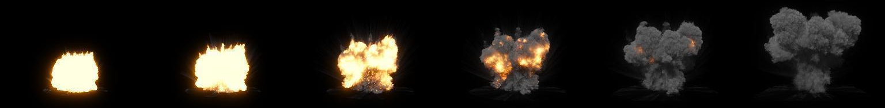
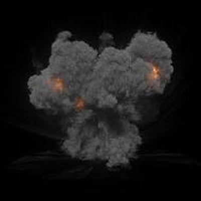
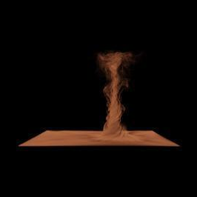
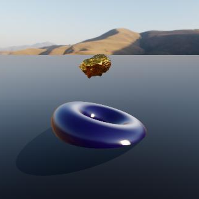
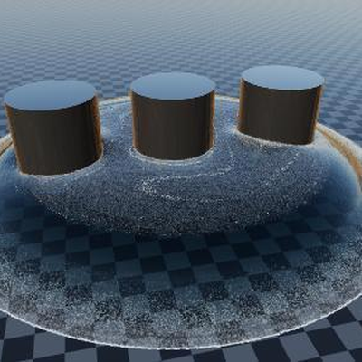
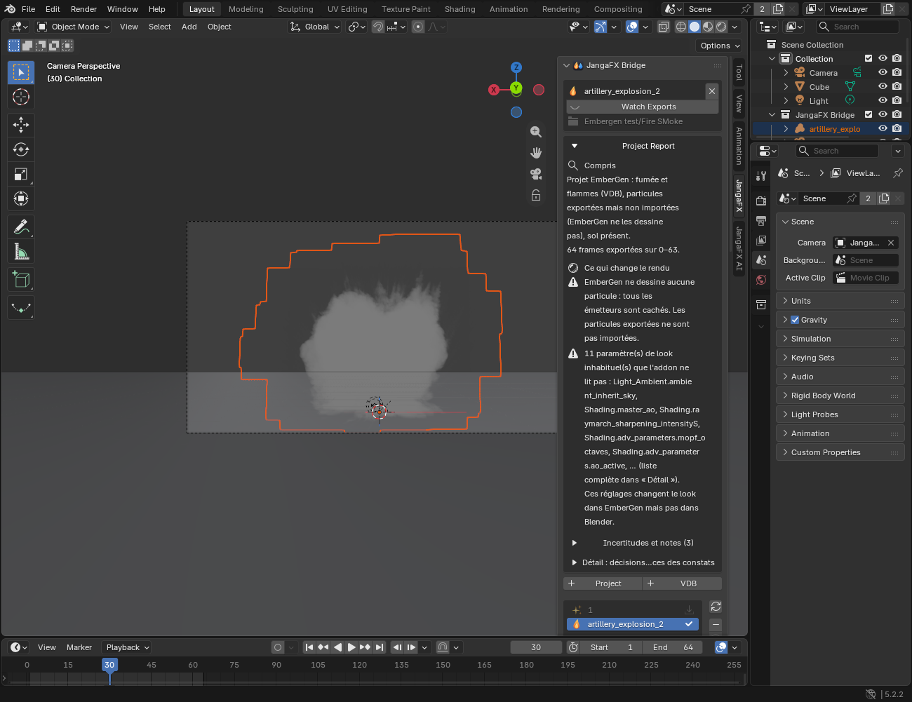

  &nbsp;&nbsp;&nbsp;
  &nbsp;&nbsp;&nbsp;
  

<h1 align="center">JangaFX Bridge</h1>

  <b>EmberGen et LiquiGen dans Blender : ouvrez le projet, le rendu est prêt.</b> 
  Add-on Blender 4.5+ — import, look et rechargement en direct des exports de la suite JangaFX.

  
  
  
  
  

  <a href="https://thomasdm40-dev.github.io/jangafx-bridge-releases/"><b>Documentation</b></a> ·
  <a href="https://thomasdm40-dev.github.io/jangafx-bridge-releases/en/"><b>English</b></a> ·
  <a href="https://thomasdm40-dev.github.io/jangafx-bridge-releases/liquigen/"><b>Documentation LiquiGen</b></a> ·
  <a href="https://github.com/ThomasDM40-dev/jangafx-bridge-releases/releases/latest"><b>Télécharger</b></a>

   
  Glissez ce bouton dans la fenêtre de Blender 4.5+ : Blender propose d'ajouter le dépôt, puis installe l'add-on.

## Ce que fait l'add-on

<table>
<tr>
<td width="50%" valign="top">
&nbsp;<b>EmberGen</b> — fumée, feu, étincelles 

- ouvre le projet `.ember` et importe tout seul les VDB et les particules Alembic ;
- reconstruit le look : matériaux, lueurs, lumières, caméra, sol, post-traitement ;
- compare le rendu Blender au flipbook d'EmberGen et cale le look (**Auto Match**).

</td>
<td width="50%" valign="top">
&nbsp;<b>LiquiGen</b> — liquides 

- ouvre le projet `.liquigen` : liquide, écume, embruns et bulles ;
- matériau du liquide, soleil, ciel, sol et caméra du projet ;
- compare le rendu Blender à une capture de LiquiGen.

</td>
</tr>
</table>

Pour les deux : le dossier des exports est surveillé (réexport = mise à jour dans Blender), l'effet s'exporte en
`.blend` autonome pour n'importe quelle scène, et un assistant IA local (Ollama) retouche le look à la demande.

## Galerie

<table>
<tr>
<td></td>
<td></td>
<td></td>
</tr>
<tr>
<td align="center">Feu</td>
<td align="center">Explosion et fumée</td>
<td align="center">Tornade de poussière</td>
</tr>
<tr>
<td></td>
<td></td>
<td></td>
</tr>
<tr>
<td align="center">Or liquide</td>
<td align="center">Tourbillon et écume</td>
<td align="center"><a href="https://thomasdm40-dev.github.io/jangafx-bridge-releases/liquigen/">Documentation LiquiGen</a></td>
</tr>
</table>

Aperçus enregistrés dans des projets EmberGen et LiquiGen ouverts par l'add-on.

## Dans Blender

L'onglet **JangaFX** (touche **N** dans la vue 3D) : le projet, ses exports, le rapport et tous les réglages du look.

## Installer avec mises à jour automatiques (recommandé)
1. Blender > Edit > Preferences > Get Extensions > menu **Repositories** (en haut à droite) > **+** > **Add Remote Repository**.
2. URL : `https://raw.githubusercontent.com/ThomasDM40-dev/jangafx-bridge-releases/main/index.json`
3. Cocher **Check for Updates on Startup**, valider, puis installer **JangaFX Bridge** dans la liste.

Les nouvelles versions apparaissent ensuite toutes seules dans Blender (bouton Update).

## Installer à la main
Télécharger `jangafx_bridge-x.y.z.zip` dans [Releases](https://github.com/ThomasDM40-dev/jangafx-bridge-releases/releases), puis
Preferences > Get Extensions > menu > **Install from Disk…**.

---

  &nbsp; 
  EmberGen et LiquiGen sont des marques de JangaFX ; leurs logos désignent ici les logiciels.

