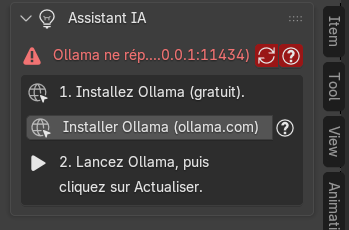
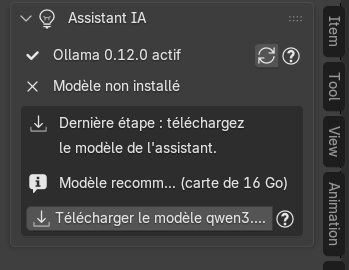
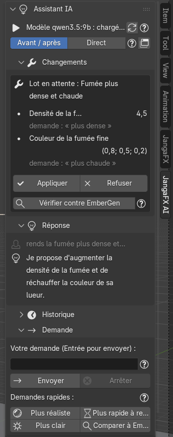

*[English version](en/assistant-ia.md)*

# L'assistant IA

L'onglet **JangaFX AI** du panneau latéral (touche **N**) contient un assistant qui comprend vos demandes en
français, par exemple « rends la fumée plus dense », et propose les changements correspondants. Il tourne **sur
votre ordinateur** grâce au programme gratuit **Ollama** : rien n'est envoyé sur Internet. L'add-on fonctionne
très bien sans lui.

Il faut une carte graphique avec au moins 8 Go de mémoire.

## Installer Ollama et le modèle

L'onglet vous guide pas à pas. Tant qu'Ollama ne répond pas, il affiche :

1. **Installez Ollama (gratuit)** : le bouton **Installer Ollama (ollama.com)** ouvre la page de téléchargement
   officielle (<https://ollama.com/download>) dans votre navigateur. L'add-on n'installe rien lui-même :
   téléchargez et installez Ollama comme un programme ordinaire.
2. **Lancez Ollama, puis cliquez sur Actualiser** (le bouton flèches à droite de la ligne d'état).

Quand Ollama répond, la ligne dit « Ollama … actif ». **Dernière étape** : téléchargez le modèle de l'assistant
avec le bouton **Télécharger le modèle …**. Le modèle recommandé dépend de la mémoire de votre carte graphique. Le
téléchargement fait plusieurs Go et ne se fait qu'une fois ; Blender reste utilisable pendant ce temps, une barre
montre l'avancement et **Annuler le téléchargement** l'arrête.

La ligne d'état indique ensuite si le modèle est **chargé** (avec la mémoire graphique qu'il occupe) ou
**déchargé** (installé mais pas en mémoire). Le modèle est toujours déchargé avant un rendu, une vérification ou un
Auto Match, pour libérer la carte graphique.

## Les deux modes

Sous la ligne d'état, choisissez comment l'assistant applique ses changements :

- **Avant / après** (par défaut) : l'assistant prépare ses changements sans toucher à la scène. Vous voyez la
  liste des changements, et un rendu avant / après à côté de la référence EmberGen, puis vous appliquez ou
  refusez.
- **Direct** : les changements sont appliqués tout de suite ; **Annuler** (ou Ctrl+Z) les retire.

Le petit bouton fenêtre au bout de la ligne ouvre la conversation en grand (voir plus bas).

## Poser une question

Dans la partie **Demande** :

1. tapez votre demande dans le champ **Votre demande** (par exemple « rends la fumée plus dense et plus chaude ») ;
2. appuyez sur **Entrée** ou cliquez sur **Envoyer**.

**Arrêter** interrompt la réponse en cours (et la vérification ou l'Auto Match qu'elle attend).

Les **demandes rapides** envoient une phrase toute prête, comme si vous l'aviez tapée : **Plus réaliste**, **Plus
rapide à rendre**, **Plus clair**, **Comparer à EmberGen** (lance une vérification et dit ce qui diffère le plus).

La partie **Réponse** montre votre dernière question (en gris) et la réponse de l'assistant ; **Historique** garde
les échanges précédents.

## Appliquer, refuser, annuler

Chaque proposition arrive dans la partie **Changements**, sous forme de **lot** : une ligne par réglage, avec
l'ancienne et la nouvelle valeur, et en petit la **source** de la valeur (votre demande, ou la mesure d'un outil).

En mode **Avant / après** :

- **Voir avant / après** ouvre l'image (avant | après | référence EmberGen) dans une fenêtre, quand l'aperçu est
  prêt ;
- **Appliquer** écrit les changements dans la scène (vous pouvez l'annuler) ;
- **Refuser** les abandonne : rien n'a été touché ;
- **Vérifier contre EmberGen** lance une [vérification](verifier-et-auto-match.md#vérifier-contre-embergen) sur ce
  lot dans un Blender d'arrière-plan (plusieurs minutes sur un gros projet) et dit si le lot éloigne le rendu
  d'EmberGen. Rien n'est annulé automatiquement : vous décidez.

Après application :

- **Annuler** remet les valeurs d'avant le dernier lot appliqué (réglages, préréglage et objets ajoutés) ;
  le Ctrl+Z de Blender marche aussi ;
- **Revenir à cet état**, sur un lot plus ancien, revient à l'état laissé par ce lot.

Dans la partie **Outils** :

- **Effacer les réglages IA** retire tout ce que l'assistant a changé sur l'import actif (annulable) ;
- **Effacer la conversation** vide l'historique des messages ; les réglages déjà appliqués restent.

## Ouvrir en grand

**Ouvrir en grand** (partie **Historique** ou **Outils**, ou le bouton fenêtre en haut) ouvre une grande fenêtre
avec toute la conversation, en lecture seule. Sa barre latérale (touche **N**, onglet **JangaFX AI**) garde les
changements et le champ de demande. Si la fenêtre est déjà ouverte, elle est seulement mise à jour. Quand une
réponse est trop longue pour le panneau, le lien **… voir tout** ouvre aussi cette fenêtre.

## Réglages de l'assistant

Dans **Edit > Preferences > Add-ons > JangaFX Bridge**, le bloc **Assistant IA (Ollama)** reprend l'état d'Ollama
et le téléchargement du modèle, plus trois réglages :

- **Modèle imposé** : le modèle Ollama à utiliser (par exemple `qwen3.5:4b`). Vide : choix automatique parmi les
  modèles installés, selon la mémoire graphique libre.
- **Garder le modèle chargé (min)** : minutes pendant lesquelles Ollama garde le modèle en mémoire après le dernier
  message (0 : déchargé aussitôt).
- **Serveur Ollama** : adresse du serveur (par défaut `http://127.0.0.1:11434`). Ne changez rien si Ollama tourne
  sur cet ordinateur avec ses réglages par défaut.

Si l'onglet affiche « Assistant IA indisponible (voir la console de Blender) », l'assistant n'a pas pu se charger ;
le reste de l'add-on fonctionne normalement.
