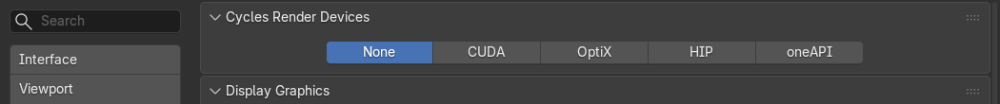

*[Version française](../depannage.md)*

# Troubleshooting

The most common problems and what to do. Also remember to read the
[project report](premiers-pas.md#the-project-report): it flags many of these cases and often offers
the right button.

## VDBs are slow to read

**What you see**: Blender takes a long time to change frame; the **Export** section shows "Slow to read: no
grid index" and the report says "The VDBs have no grid table: slow reading".

**Why**: the VDBs written by EmberGen have no grid table. Blender re-reads the whole file for
each grid, at every frame.

**What to do**: click **Optimize VDB Files** (**Export** section, or directly in the report). The add-on
writes an indexed, lossless copy (same grids, same values) in a `JangaFX Optimized` subfolder next to
the export, then uses it: the line becomes "Optimized VDB copy in use". Allow for the disk space
(the size is shown under the button). Esc during the conversion cancels it (files already converted are
kept).

## The material comes from an older version

**What you see**: the report says "The material was built by another version of the EmberGen look".

**Why**: the add-on was updated since the import; your file's material dates from the old version.

**What to do**: click the button offered in the report, **Rebuild Material (Reload)**, or **Reload**
in the **Export** section. The material is rebuilt from the project.

## Colours change after adding the effect

**What you see**: after adding an effect exported as `.blend` to another scene, it does not have the
same colours; the **Export to .blend** section shows "colour settings differ from the source file, the effect
may look different" or "render settings differ from the source file".

**Why**: colour grading, render settings, post-processing and the world stay those of the
scene that receives the effect (see [What stays with the receiving scene](export.md#what-stays-with-the-receiving-scene)).
The add-on never changes them for you.

**What to do**:

- in the receiving scene, compare **Render Properties > Color Management** with the working file's;
  choose to keep the scene's (and tweak the effect) or to change it for the whole scene;
- the render settings line says which ones differ (volume step, bounces, motion blur,
  post-processing, world): align the ones that matter to you.

## The speed is wrong

**What you see**: the effect plays too fast or too slowly; the **Export to .blend** section shows
"made at 60 fps, this scene plays it at another speed".

**Why**: the effect was made at a different frame rate than the scene that receives it. A VDB sequence has one file
per project frame.

**What to do**: set the scene's frame rate (**Output Properties > Frame Rate**) to the effect's, or
accept the difference. In a project opened with the add-on, **Frame Rate** in
[Project scene](panneau.md#project-scene) sets the scene's frame rate to the project's.

## Files are missing

**What you see**: in the list, the export has a red triangle ("Files missing"), or the **Export** section
shows "… missing frame(s)"; or an effect added from a `.blend` does not appear.

**Why**: export files were moved, deleted, or the export is not finished. An effect
exported as `.blend` reads its VDBs and caches at their original path.

**What to do**:

- re-run the export from EmberGen or LiquiGen, then click **Rescan** or **Reload**;
- if you moved the exports folder, change **Export Folder** in **Settings**;
- do not move the exports folder of an effect you added as `.blend`;
- if Open Project says "No export of this project was found on disk", export from EmberGen first.

## The graphics card is not used

**What you see**: checks and Auto Match are very slow, or the AI assistant answers "No graphics card
is enabled for Cycles".

**Why**: the background Blender uses the graphics card chosen for Cycles in Blender's
preferences. If none is chosen, it renders with the processor.

**What to do**:

1. open **Edit > Preferences > System**;
2. in **Cycles Render Devices**, choose **CUDA** or **OptiX** (NVIDIA), **HIP** (AMD), **oneAPI** (Intel) or
   **Metal** (Mac), then tick your card;
3. in the add-on preferences, leave **GPU for Background Renders** ticked.

The background render shares the card's memory with your session: on a small card, close other
demanding programs during a check.

## A check refuses to start

- "Fix the scene first (… problem(s) in the project report)": first fix what the report says (for
  example a missing project light: **Apply Project Scene**).
- "A background check or Auto Match is already running": wait for the current job to finish, or stop it
  with the cross.
- "Needs the EmberGen project (.ember) of this export": the export has no `.ember` project next to it; open it
  with **Open Project**.
- "EmberGen only saved a thumbnail in the project": add a screenshot in **Screenshot** (see
  [The reference](verifier-et-auto-match.md#the-reference-what-embergen-rendered)).
