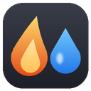
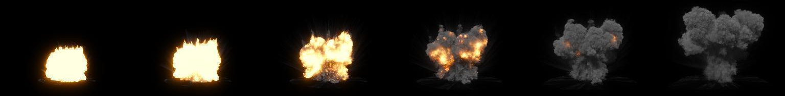
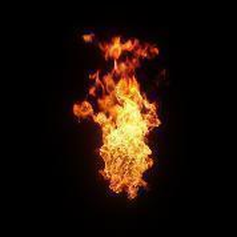
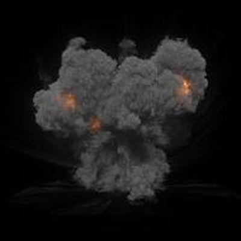
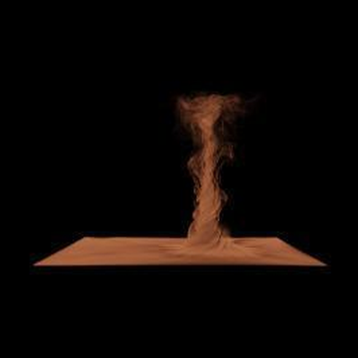
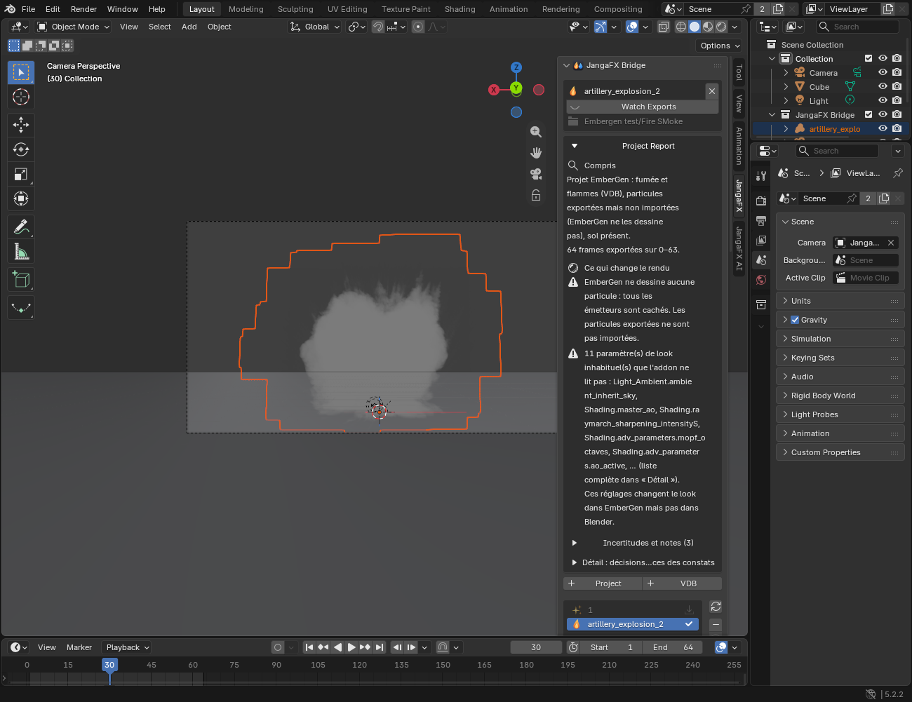

*[Version française](../index.md)*

# JangaFX Bridge for EmberGen

Documentation · JangaFX Bridge for Blender

Your EmberGen effects, rendered in Blender

Open the <code>.ember</code> project: smoke, fire, sparks, lights, camera and ground are ready to
render, with the EmberGen look.

.ember projects
Blender 4.5 and later
VDB and Alembic
Cycles render

This documentation mainly covers **EmberGen**; the switch at the top of the page goes to the **LiquiGen**
version.

## What the add-on does

JangaFX Bridge links EmberGen (smoke, fire, sparks) with Blender:

- you open your EmberGen (`.ember`) project directly in Blender;
- the add-on automatically finds the exported files (VDB, Alembic), imports them and rebuilds the project's render:
  materials, lights, camera, ground, post-processing, frame rate and frame range;
- it watches the exports folder: when you re-export from EmberGen, Blender updates;
- it compares Blender's render to EmberGen's and can match the look on its own (**Auto Match**);
- it exports the finished effect as a standalone `.blend`, to add to any other scene (for example sparks in a
  Formula 1 scene);
- an AI assistant, running on your computer, can tweak the look on request.

## Contents

1. [Installation](installation.md) — install the add-on and receive updates automatically.
2. [Getting started](premiers-pas.md) — open a project, what appears in the scene, read the report.
3. [The JangaFX panel](panneau.md) — every section of the panel, setting by setting.
4. [Check against EmberGen and Auto Match](verifier-et-auto-match.md) — compare with EmberGen and match the look.
5. [Export the effect to .blend](export.md) — put the effect in another scene.
6. [The AI assistant](assistant-ia.md) — install Ollama and ask for tweaks.
7. [Troubleshooting](depannage.md) — common problems and their solutions.

## Where to find the add-on in Blender

In the 3D viewport, press **N** to open the sidebar, then click the **JangaFX** tab (the **JangaFX AI** tab
contains the AI assistant). Button labels are in English, like the rest of Blender; this
documentation gives their exact name in **bold**.

The **Documentation** button, at the bottom of the **Settings** section, opens this page. In the help popups of the
**?** buttons, the **Learn more** link opens the right section directly.
