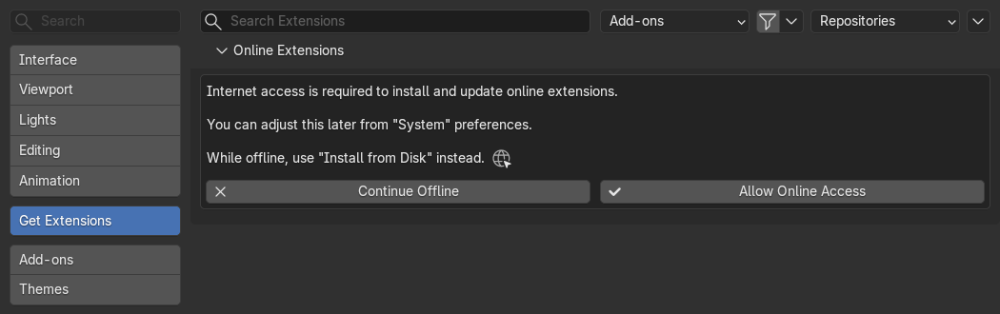
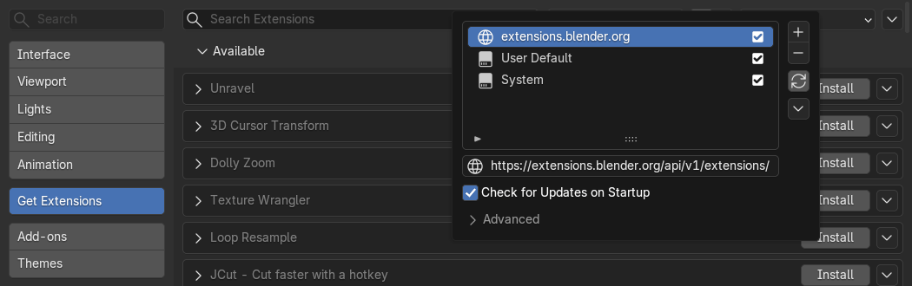
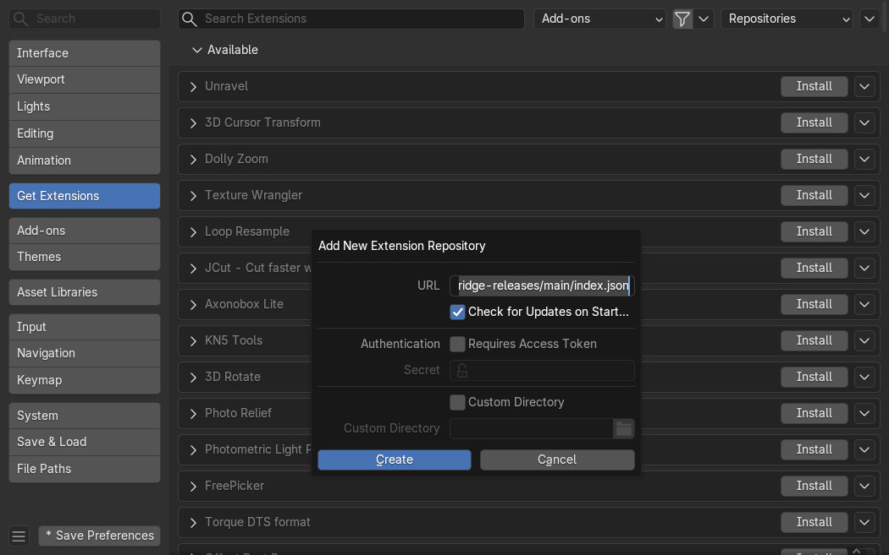
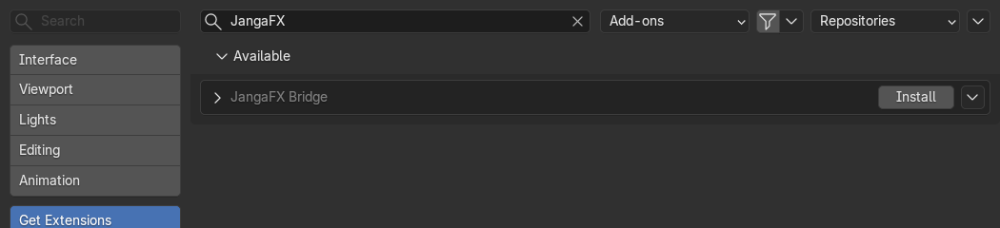
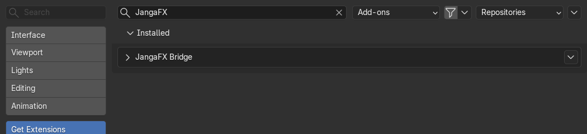
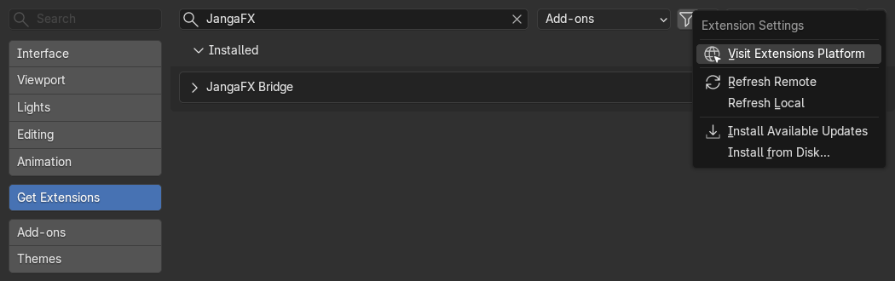
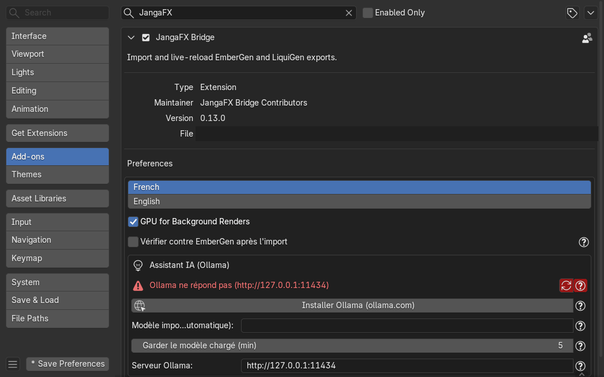

*[Version française](../installation.md)*

# Installation

JangaFX Bridge works with **Blender 4.5 or newer** (tested with 4.5 and 5.2). There are two ways to
install it: from the online repository (recommended, updates arrive on their own) or from a
`.zip` file.

The screenshots below come from Blender 5.2; in Blender 4.5 the windows are almost identical.

## Install from the online repository

This is the recommended method: at every startup, Blender checks whether a new version of the add-on exists.

### 1. Allow Internet access

Open **Edit > Preferences**, then the **Get Extensions** section. If Blender shows
the message below, click **Allow Online Access**. Without it, Blender can
download neither the add-on nor its updates.



### 2. Open the repository list

Still in **Get Extensions**, click the **Repositories** menu (top right). The repository list
opens; click the **+** button to the right of the list, then choose **Add Remote Repository**.



### 3. Add the JangaFX Bridge repository

In the **Add New Extension Repository** window:

1. paste this address into the **URL** field:

   ```
   https://raw.githubusercontent.com/ThomasDM40-dev/jangafx-bridge-releases/main/index.json
   ```

2. tick **Check for Updates on Startup**;
3. leave the rest as is and click **Create**.



### 4. Install the add-on

Type `JangaFX` in the **Get Extensions** search bar: **JangaFX Bridge** appears in the **Available** part.
Click **Install**.



Once installed, it moves to the **Installed** part and is enabled.



If the **Save Preferences** button (bottom left) shows a star, click it to keep the repository next
time (unless auto-save preferences is enabled).

## Receiving updates

With **Check for Updates on Startup** ticked, Blender checks at startup whether a new version exists. When
there is one, the **Get Extensions** section offers to update it (**Update** button, or **Install
Available Updates** in the menu at the top right). Restart Blender after an update.

## Install from a zip file

Without Internet, or to install a specific version:

1. download the `jangafx_bridge-<version>.zip` file from the releases page:
   <https://github.com/ThomasDM40-dev/jangafx-bridge-releases/releases> (do not unzip it);
2. in **Edit > Preferences > Get Extensions**, open the small menu at the very top right (the **v** arrow);
3. choose **Install from Disk...** and select the `.zip` file.



With this method, updates are not automatic: repeat the same steps with the new `.zip`.

## Check that the add-on is active

In **Edit > Preferences > Add-ons**, search for `JangaFX`: the checkbox of **JangaFX Bridge** must be ticked.
Expand the row to see its preferences:

- **French / English**: language of the project report and the help popups;
- **GPU for Background Renders**: checks and Auto Match use the graphics card chosen in
  **Preferences > System** (see [Troubleshooting](depannage.md#the-graphics-card-is-not-used));
- **Check against EmberGen after import**: see
  [Check automatically after import](verifier-et-auto-match.md#check-automatically-after-import);
- **AI assistant (Ollama)**: see [The AI assistant](assistant-ia.md).



Next, move on to [Getting started](premiers-pas.md).
