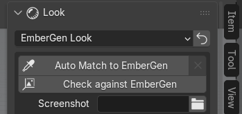

*[Version française](../verifier-et-auto-match.md)*

# Check against EmberGen and Auto Match

These tools are in the **Look** section of the panel, when the preset is **EmberGen Look** and the
`.ember` project is known.

Both work in a **background Blender**: your session stays usable and renders nothing
itself. This background Blender renders with Cycles and uses the graphics card chosen in
**Preferences > System** (see [Troubleshooting](depannage.md#the-graphics-card-is-not-used)). Only one job
at a time: during a check or an Auto Match, the line "Checking in the background..." or "Auto Match
in the background..." replaces the buttons, and the cross on the right (**Cancel Check**) stops it.

## The reference: what EmberGen rendered

To compare, you need an image from EmberGen:

- **the render saved in the project**: EmberGen keeps a small movie of the simulation in the `.ember`; it is
  used automatically when it shows frames that were exported;
- **or a screenshot**: choose it in **Screenshot** (EmberGen's whole window or only its 3D
  view) and enter in **At Frame** the EmberGen timeline frame it shows.

If EmberGen only saved a thumbnail, the report says so ("EmberGen only saved a thumbnail in the
project: no reference render to compare with") and suggests adding a screenshot. If the saved movie shows
no exported frame, re-export from EmberGen the frame range you are looking at.

## Check against EmberGen

**Check against EmberGen** renders, in the background Blender, the exported frames that the reference shows,
then compares them with EmberGen zone by zone (flame core, flames, lit smoke, smoke in shadow…). On a
large project, allow several minutes (the job is stopped after 15 minutes).

Before starting, the add-on checks the scene: if something is missing (for example a project light), it
answers "Fix the scene first (… problem(s) in the project report)" and the report says what to fix.

At the end:

- the **EmberGen | Blender** image appears under the button, side by side;
- the measured differences are added to the [project report](premiers-pas.md#the-project-report), for example
  "The lit smoke is darker" or "The effect is less spread out than in EmberGen";
- if the colours are close everywhere: "Colours close to EmberGen in all measured zones";
- if an Auto Match can help, the report offers it with its button.

When the render does not overlap the reference (another moment, another framing), only the colours are
compared, and the report says so.

## Auto Match

**Auto Match to EmberGen** matches Blender's look to the reference, with no intervention:

1. it renders a few low-resolution frames in the background Blender (the add-on's ground is hidden, because
   EmberGen does not draw one);
2. it adjusts the look's corrections one by one, measuring the gap with EmberGen over several frames;
3. it checks the result on **other frames**, never used during the search: the corrections are only
   kept if they do better there than the starting look.

**Duration**: usually 1 to 5 minutes, up to 30 minutes on a heavy project (forced stop after
40 minutes).

**The result** is shown under the button:

- tick: "Matched to the EmberGen render: gap 0.300 -> 0.200" (the gap went down, the corrections are
  applied);
- information icon: "**No correction kept**: none does better than the current look on frames
  outside the search". This means the corrections found improved the search frames but not
  the others: the current look is already the best, nothing was changed. This is not an error.

The note "colours only: another moment" indicates that the reference did not overlap the render: only
the colours were matched.

What is learned is kept on the export and reused for your next projects. The cross to the right of the button
(**Reset Auto Match**) forgets the corrections of this export and rebuilds the look from the project.

## Check automatically after import

In the add-on preferences (**Edit > Preferences > Add-ons > JangaFX Bridge**), the **Check against
EmberGen after import** checkbox runs **Check against EmberGen** automatically after **Open Project** or **Import** of an
EmberGen project, when a reference is usable (saved render showing exported frames, or a chosen
screenshot).

It is **unticked by default**: the background render shares the graphics card with your session. It does
nothing for LiquiGen, nor during another check or an Auto Match.

## Check a LiquiGen project

LiquiGen saves no render in its project: you need a screenshot. In the **Liquid** section:

1. take a screenshot in LiquiGen (a render, or the 3D view alone), **seen through the project camera**;
2. choose it in **LiquiGen Capture**; **At Frame** takes the scene's current frame, correct it if needed
   so that it matches the screenshot's frame;
3. click **Check against LiquiGen**.

The button stays greyed out as long as there is no screenshot; the reason is written below it. The comparison covers
shape, brightness, colours and highlights, and the differences are added to the report. The thresholds of this
comparison are **provisional** (not yet measured on LiquiGen screenshots); there is no Auto Match for
LiquiGen.
