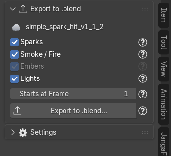
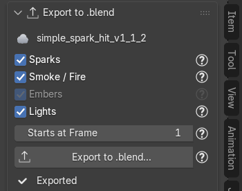
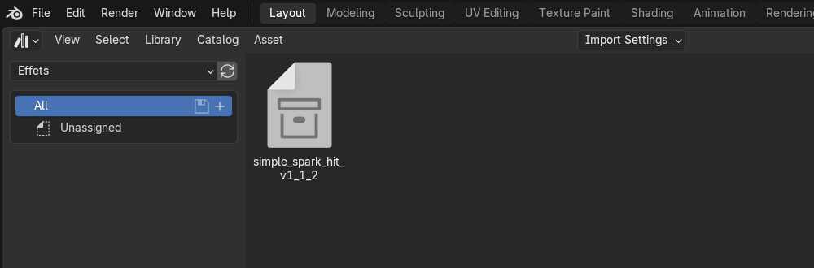
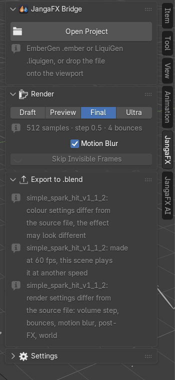

# Exporter l'effet en .blend

Cas typique : vous avez réglé des étincelles EmberGen dans un fichier de travail, et vous voulez les ajouter à la
scène de votre voiture de Formule 1. La section **Export to .blend** écrit l'effet dans un fichier `.blend`
autonome que vous ajoutez ensuite à n'importe quelle scène, **même sur un ordinateur sans l'add-on**.

## Exporter l'effet en .blend

Dans le fichier où le projet est ouvert :

1. sélectionnez un objet de l'effet (ou la ligne de l'export dans la liste) : la section **Export to .blend**
   affiche le nom du projet ;
2. cochez les parties à écrire :
   - **Sparks** (LiquiGen : **Liquid**) : les particules avec leurs Geometry Nodes et leur matériau ;
   - **Smoke / Fire** (LiquiGen : **Volumes**) : les volumes VDB avec le look EmberGen et ses lueurs ;
   - **Embers** (LiquiGen : **Bubbles**) : les objets ajoutés par l'assistant IA (grisé s'il n'y en a pas) ;
   - **Lights** : les lumières du projet (soleil, points, spots) ;
3. réglez **Starts at Frame** (voir plus bas) ;
4. cliquez sur **Export to .blend...** et choisissez où enregistrer le fichier.

Le fichier est terminé par un Blender d'arrière-plan : la ligne « Exporting in the background... » s'affiche (la
croix l'annule, rien n'est écrit). À la fin, la ligne verte dit « Exported <projet> to <fichier> ». Votre fichier
de travail, lui, n'est pas modifié.

Si vous décochez **Sparks** alors que la lueur des étincelles dans la fumée en a besoin, les étincelles sont quand
même écrites, mais cachées : la fumée reste éclairée pareil.

**Le soleil** éclaire aussi toute la scène qui reçoit l'effet. Pour garder seulement l'éclairage de la scène de la
voiture, décochez **Lights**.

## Choisir la frame de départ

**Starts at Frame** est l'image du fichier qui reçoit l'effet où joue sa première image. Par défaut, c'est celle
de l'export dans votre fichier de travail. Le décalage s'applique aux VDB, aux caches Alembic, aux clés du look et
aux naissances des étincelles, **dans le fichier écrit seulement**.

Exemple : la voiture passe devant la caméra à l'image 120 et les étincelles doivent jaillir à ce moment-là : mettez
120.

## Ce qui est figé

Le fichier écrit est **figé** : toutes les valeurs restent celles calculées depuis le projet à l'import (la largeur
des étincelles, par exemple, a été calculée d'après la résolution de rendu de votre fichier de travail). Rien n'est
recalculé d'après la résolution, la caméra, la cadence ou l'étalonnage du fichier qui le reçoit, et l'add-on de ce
fichier ne le modifie jamais.

Le fichier contient :

- une **collection** au nom du projet, marquée comme **asset** ;
- un **parent commun**, l'objet « <projet> · Root », pour tout déplacer d'un coup ;
- des **noms préfixés** par le projet (« <projet> · <nom> ») : rien ne se mélange avec un autre effet.

**Les fichiers VDB ne sont pas copiés** : ils restent sur le disque, à leur chemin complet (la copie optimisée
si **Optimize VDB Files** a été utilisé). Ne déplacez pas et ne supprimez pas le dossier des exports tant que vous
utilisez l'effet.

## Ajouter l'effet dans une autre scène

Ouvrez la scène qui doit recevoir l'effet (la voiture), puis au choix :

**Avec File > Append** : **File > Append**, choisissez le fichier `.blend` exporté, entrez dans le dossier
**Collection** et choisissez la collection au nom du projet.

**Avec l'Asset Browser** : ajoutez le dossier du fichier exporté comme bibliothèque d'assets (**Edit > Preferences
> File Paths > Asset Libraries**, ou **Asset Libraries** selon la version), ouvrez un éditeur **Asset Browser**,
choisissez cette bibliothèque, puis glissez l'effet dans la vue 3D.

## Déplacer l'effet

Sélectionnez l'objet **« <projet> · Root »** (dans l'Outliner) et déplacez-le, tournez-le ou changez son échelle :
tout l'effet suit, soleil compris.

## Ce qui reste celui de la scène qui reçoit

L'effet apporte ses objets, ses matériaux et ses lumières, mais **pas les réglages de la scène**. Ceux-ci restent
ceux de la scène de la voiture, et l'add-on n'y touche pas :

- l'étalonnage des couleurs (**Color Management** : View Transform, Look, exposition, courbe) ;
- la cadence (images par seconde) ;
- les réglages de rendu Cycles : pas et rebonds dans les volumes, rebonds de lumière ;
- le flou de mouvement ;
- le film transparent ;
- le post-traitement fait dans le compositing (halo, saturation, vignette…) ;
- le monde (**World**) ;
- la caméra : celle du projet n'est pas exportée, l'effet est vu par la caméra de la scène qui le reçoit.

Le résultat peut donc être différent de votre fichier de travail. Pour vous prévenir, la section **Export to
.blend** de la scène qui reçoit affiche une ligne par différence (rien n'est corrigé automatiquement) :

- « <effet>: colour settings differ from the source file, the effect may look different » : l'étalonnage
  diffère ;
- « <effet>: made at 60 fps, this scene plays it at another speed » : la cadence diffère ;
- « <effet>: render settings differ from the source file: volume step, bounces, motion blur, post-FX, world » :
  la liste dit quels réglages de rendu diffèrent.

Que faire : voir [Les couleurs changent après l'ajout](depannage.md#les-couleurs-changent-après-lajout) et
[La vitesse n'est pas la bonne](depannage.md#la-vitesse-nest-pas-la-bonne).
