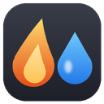
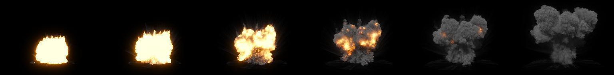
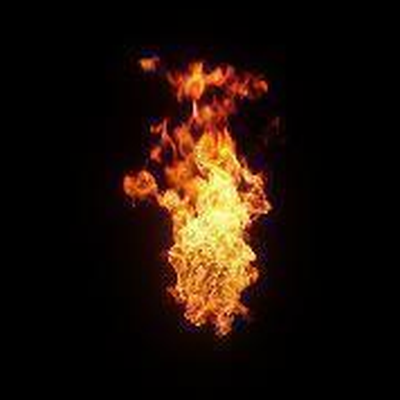
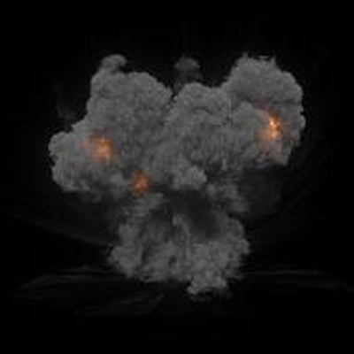
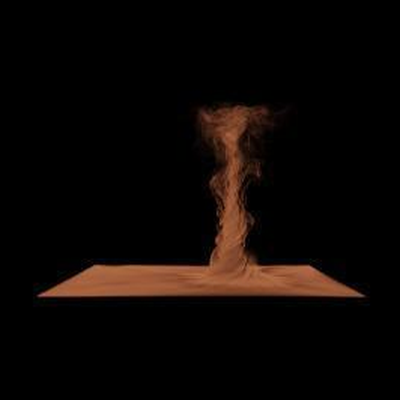
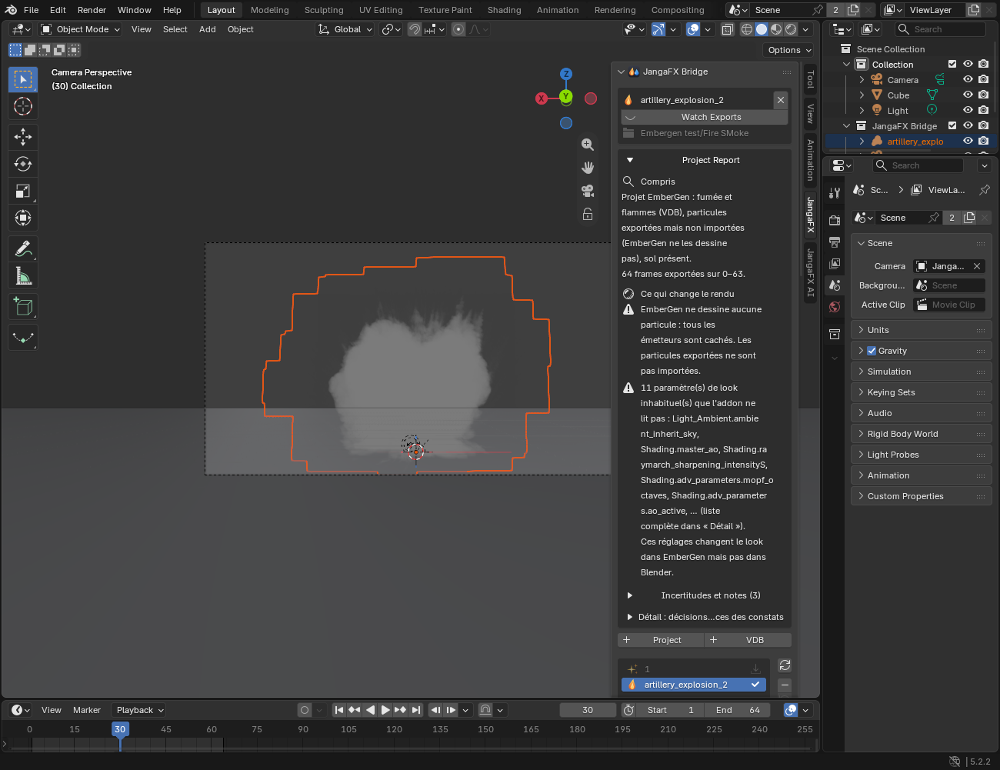

*[English version](en/index.md)*

# JangaFX Bridge pour EmberGen

Documentation · JangaFX Bridge pour Blender

Vos effets EmberGen, rendus dans Blender

Ouvrez le projet <code>.ember</code> : la fumée, le feu, les étincelles, les lumières, la caméra et le
sol sont prêts au rendu, avec le look d'EmberGen.

Projets .ember
Blender 4.5 et plus
VDB et Alembic
Rendu Cycles

Cette documentation parle surtout d'**EmberGen** ; le sélecteur en haut de la page passe à la version
**LiquiGen**.

## Ce que fait l'add-on

JangaFX Bridge fait le lien entre EmberGen (fumée, feu, étincelles) et Blender :

- vous ouvrez votre projet EmberGen (`.ember`) directement dans Blender ;
- l'add-on retrouve tout seul les fichiers exportés (VDB, Alembic), les importe et reconstruit le rendu du projet :
  matériaux, lumières, caméra, sol, post-traitement, cadence et plage d'images ;
- il surveille le dossier des exports : quand vous réexportez depuis EmberGen, Blender se met à jour ;
- il compare le rendu de Blender à celui d'EmberGen et peut caler le look tout seul (**Auto Match**) ;
- il exporte l'effet terminé en `.blend` autonome, à ajouter dans n'importe quelle autre scène (par exemple des
  étincelles dans une scène de Formule 1) ;
- un assistant IA, qui tourne sur votre ordinateur, peut retoucher le look à votre demande.

## Sommaire

1. [Installation](installation.md) — installer l'add-on et recevoir les mises à jour automatiquement.
2. [Premiers pas](premiers-pas.md) — ouvrir un projet, ce qui apparaît dans la scène, lire le rapport.
3. [Le panneau JangaFX](panneau.md) — chaque section du panneau, réglage par réglage.
4. [Vérifier contre EmberGen et Auto Match](verifier-et-auto-match.md) — comparer à EmberGen et caler le look.
5. [Exporter l'effet en .blend](export.md) — mettre l'effet dans une autre scène.
6. [L'assistant IA](assistant-ia.md) — installer Ollama et demander des retouches.
7. [Dépannage](depannage.md) — les problèmes courants et leurs solutions.

## Où trouver l'add-on dans Blender

Dans la vue 3D, appuyez sur **N** pour ouvrir le panneau latéral, puis cliquez sur l'onglet **JangaFX** (l'onglet
**JangaFX AI** contient l'assistant IA). Les textes des boutons sont en anglais, comme le reste de Blender ; cette
documentation donne leur nom exact en **gras**.

Le bouton **Documentation**, en bas de la section **Settings**, ouvre cette page. Dans les fenêtres d'aide des
boutons **?**, le lien **En savoir plus** ouvre directement la bonne section.
