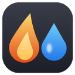
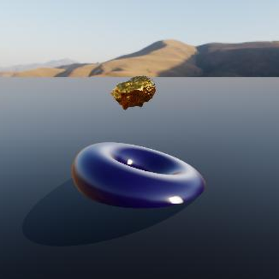
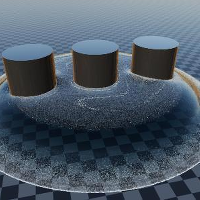

*[Version française](../index.md)*

# JangaFX Bridge for LiquiGen

Documentation · JangaFX Bridge for Blender

Your LiquiGen liquids, rendered in Blender

Open the <code>.liquigen</code> project: the liquid, foam, spray, bubbles, camera, sun and ground are
ready to render.

LiquiGen 1.0 to 1.2
Blender 4.5 and later
Alembic and VDB
Cycles render

This version of the documentation covers **LiquiGen** only. For EmberGen (smoke, fire, sparks), see the
[full documentation](../../en/index.md).

## What the add-on does

JangaFX Bridge links LiquiGen with Blender:

- you open your LiquiGen project (`.liquigen`) directly in Blender;
- the add-on automatically finds the project's exports (the liquid, and the white water particles: foam, spray,
  bubbles), imports them and rebuilds the scene: liquid material, sun, ground, camera, frame rate and frame range;
- it watches the exports folder: when you re-export from LiquiGen, Blender updates;
- it compares Blender's render to a LiquiGen capture and lists the differences;
- it exports the finished liquid as a standalone `.blend`, to add to any other scene.

## Contents

1. [Installation](../../en/installation.md) — install the add-on and receive updates (shared with EmberGen).
2. [Getting started with LiquiGen](premiers-pas.md) — export from LiquiGen, open the project, read the report.
3. [The Liquid section](liquide.md) — the liquid look, foam, smoothing, white water particles.
4. [Check and export](verifier-et-exporter.md) — compare to a LiquiGen capture, export as `.blend`.
5. [Troubleshooting](../../en/depannage.md) — common problems (shared with EmberGen).

## Where to find the add-on in Blender

In the 3D viewport, press **N** to open the sidebar, then click the **JangaFX** tab. This documentation gives
the exact button names in **bold**.

<a class="cross" href="../../en/index.md">Working with EmberGen too?<small>The full documentation covers EmberGen and LiquiGen.</small></a>
