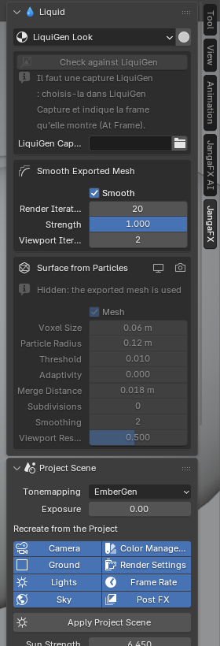

*[Version française](../liquide.md)*

# The Liquid section

The **Liquid** section of the JangaFX panel appears when a LiquiGen project is open. It sets everything about
the liquid.

## The liquid look

The **LiquiGen Look** menu chooses the liquid material:

- the **LiquiGen project appearance** (default): colour, transparency and reflections read from the project;
- or one of your **water materials** found in your asset libraries: it is added once to the file, with its
  textures linked.

With a library material, the AI assistant does not change the liquid.

The button to the right of the menu (**Detail Preview**) sets the 3D viewport to read the liquid details well:
Solid mode, glossy matcap, foam in white, more smoothing.

## Surface foam

**Surface Foam** paints foam on the liquid surface. It is **off on import**: the foam comes from the particles
exported by LiquiGen. Once on (in the viewport and in the render), you set:

- its **Shader** (empty: built-in white foam);
- its amount and shape: **Coverage**, **Threshold**, **Softness**, **Lace Scale**, **Lace Width**, **Lace
  Amount**, **Distortion**, **Foam Height**;
- the froth: **Bubble Size**, **Bubble Variation**, **Bubble Relief**, **Translucency**, **Color**.

> These values are the add-on's choices: LiquiGen has no equivalent, nothing is read from the project.

## The liquid surface

- **Smooth Exported Mesh**: smoothing of the mesh exported by LiquiGen.
- **Surface from Particles**: surface rebuilt from the liquid particles. This setting is hidden when the exported
  mesh is used.

## White water particles

One box appears per type of white water particles the project simulates: **foam**, **spray** and **bubbles**.
Each has its render button, to show or hide it in the render.

Types the project does not simulate are not imported, even if LiquiGen wrote empty objects for them.

## The project scene

The **Project Scene** section recreates the project's setting: camera, sun, sky and ground. Each setting is
described in [Project scene](../../en/panneau.md#project-scene).
