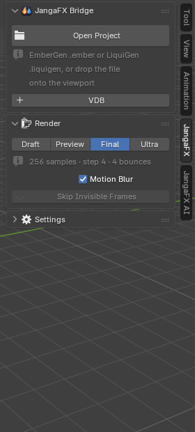
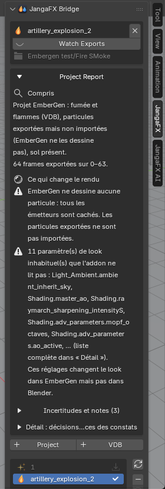

*[Version française](../premiers-pas.md)*

# Getting started with LiquiGen

> If the add-on is not installed yet, follow the [Installation](../../en/installation.md) page first.

## Before you start

In LiquiGen:

1. export the simulation with the project's export nodes (the liquid, and foam, spray or bubbles if the project
   simulates them);
2. save the project (`.liquigen`).

The add-on finds the exports through the export nodes saved in the project: an export made before the last path
change will not be found.

## Open the JangaFX panel

In the 3D viewport, press **N**: the sidebar opens. Click the **JangaFX** tab (on the right edge of the sidebar).
As long as no project is open, it only shows the **Open Project** button, the **+ VDB** button, the **Render**
section and the **Settings** section (collapsed).

## Open a LiquiGen project

1. Click **Open Project**.
2. Choose the `.liquigen` file.

You can also **drag the project file** from the file explorer straight into the 3D viewport.

The add-on reads the project, imports the exports and sets up the rest automatically. A heavy project can take a
few seconds.

If nothing is found, Blender shows "No export of this project was found on disk (export it from EmberGen
first)": export from LiquiGen first (the message names EmberGen, it applies to LiquiGen too).

To put **several effects** in the same scene, click **+ Project** under the project card (see [Project and
exports list](../../en/panneau.md#project-and-exports-list)).

## What appears in the scene

After opening, the scene contains:

- a **JangaFX Bridge** collection with the liquid (the exported mesh, or a surface rebuilt from the particles) and
  the white water particles the project simulates: foam, spray, bubbles;
- the project camera, the project sun and sky, and the ground if the project's Ground node is active;
- the scene frame range and frame rate matched to the export.

To look at the render in the 3D viewport, switch to **Material Preview** or **Rendered** shading (top right of
the 3D viewport). The final render uses **Cycles**.

## The exports folder

On opening, the add-on takes as **exports folder** the folder where the project's export nodes write their
files; it is shown under the project name. The **Watching Exports** button (eye) shows that this folder is
watched: when you re-export from LiquiGen, the list updates and the imported liquid reloads (if **Auto Reload**
is checked).

To watch another folder, change **Export Folder** in the **Settings** section (see
[Settings](../../en/panneau.md#settings)).

## The project report

Right under the project name, the **Project Report** explains what the add-on understood from the project and
what can make the result differ from LiquiGen, most serious first. A text copy is written next to the project
(`<project>.jfxb_report.txt`).

Each part of the report is described in [Getting started](../../en/premiers-pas.md#the-project-report) of the
full documentation.

## Next

- Tune the liquid: [The Liquid section](liquide.md).
- Compare to LiquiGen or export: [Check and export](verifier-et-exporter.md).
