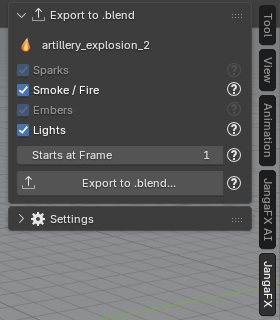

*[Version française](../verifier-et-exporter.md)*

# Check and export

## Check against a LiquiGen capture

LiquiGen stores no render in its project: to compare, you need a capture. In the **Liquid** section:

1. take a capture in LiquiGen (a render, or the 3D view alone), **seen through the project camera**;
2. choose it in **LiquiGen Capture**; **At Frame** takes the current scene frame, correct it if needed so it
   matches the frame of the capture;
3. click **Check against LiquiGen**.

The button stays greyed out as long as there is no capture; the reason is written below. The comparison covers
shape, brightness, colours and reflections, and the differences are added to the project report.

> The thresholds of this comparison are **provisional** (not yet measured on LiquiGen captures). There is no Auto
> Match for LiquiGen.

## Export the liquid as .blend

The **Export to .blend** section writes the liquid into a standalone `.blend` file that you then add to any
scene, **even on a computer without the add-on**.

1. Select an object of the liquid (or the export's row in the list): the section shows the project name.
2. Check the parts to write:
   - **Liquid**: the liquid and its white water particles, with their Geometry Nodes and materials;
   - **Volumes**: the project's VDB volumes, if any;
   - **Bubbles**: the bubbles added by the AI assistant (greyed out if there are none);
   - **Lights**: the project sun.
3. Set **Starts at Frame**: the frame of the receiving file where the liquid's first frame plays.
4. Click **Export to .blend...** and choose where to save the file.

The file is written by a background Blender; your working file is not changed. The sun also lights the whole
scene that receives the liquid: uncheck **Lights** to keep only that scene's lighting.

The files exported by LiquiGen **are not copied**: they stay at their path on disk. Do not move the exports
folder while you use the liquid.

To add the file to another scene (File > Append or Asset Browser) and for what is frozen, see [Export the effect
as .blend](../../en/export.md).

## If something goes wrong

The [Troubleshooting](../../en/depannage.md) page lists common problems and their fixes.
