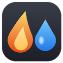
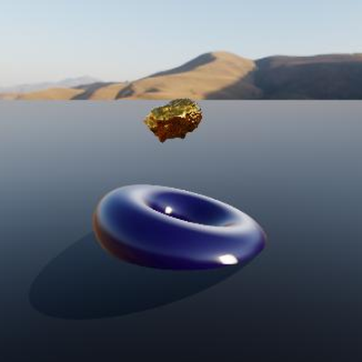
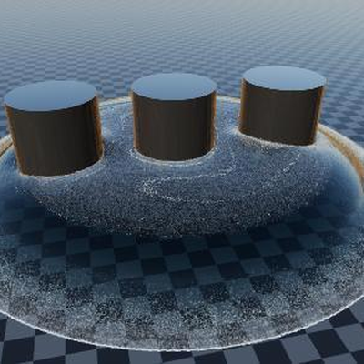

*[English version](en/index.md)*

# JangaFX Bridge pour LiquiGen

Documentation · JangaFX Bridge pour Blender

Vos liquides LiquiGen, rendus dans Blender

Ouvrez le projet <code>.liquigen</code> : le liquide, l'écume, les embruns, les bulles, la caméra, le
soleil et le sol sont prêts au rendu.

LiquiGen 1.0 à 1.2
Blender 4.5 et plus
Alembic et VDB
Rendu Cycles

Cette version de la documentation ne parle que de **LiquiGen**. Pour EmberGen (fumée, feu, étincelles), voir la
[documentation complète](../index.md).

## Ce que fait l'add-on

JangaFX Bridge fait le lien entre LiquiGen et Blender :

- vous ouvrez votre projet LiquiGen (`.liquigen`) directement dans Blender ;
- l'add-on retrouve tout seul les exports du projet (le liquide, et les particules blanches : écume, embruns,
  bulles), les importe et reconstruit la scène : matériau du liquide, soleil, sol, caméra, cadence et plage
  d'images ;
- il surveille le dossier des exports : quand vous réexportez depuis LiquiGen, Blender se met à jour ;
- il compare le rendu de Blender à une capture de LiquiGen et liste les différences ;
- il exporte le liquide terminé en `.blend` autonome, à ajouter dans n'importe quelle autre scène.

## Sommaire

1. [Installation](../installation.md) — installer l'add-on et recevoir les mises à jour (commune à EmberGen).
2. [Premiers pas avec LiquiGen](premiers-pas.md) — exporter depuis LiquiGen, ouvrir le projet, lire le rapport.
3. [La section Liquid](liquide.md) — le look du liquide, l'écume, le lissage, les particules blanches.
4. [Vérifier et exporter](verifier-et-exporter.md) — comparer à une capture LiquiGen, exporter en `.blend`.
5. [Dépannage](../depannage.md) — les problèmes courants (commun à EmberGen).

## Où trouver l'add-on dans Blender

Dans la vue 3D, appuyez sur **N** pour ouvrir le panneau latéral, puis cliquez sur l'onglet **JangaFX**. Les
textes des boutons sont en anglais, comme le reste de Blender ; cette documentation donne leur nom exact en
**gras**.

<a class="cross" href="../index.md">Vous travaillez aussi avec EmberGen ?<small>Passez à la documentation EmberGen, la plus complète.</small></a>
