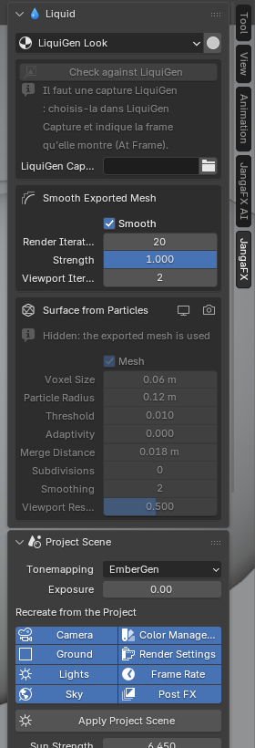

*[English version](en/liquide.md)*

# La section Liquid

La section **Liquid** du panneau JangaFX apparaît quand un projet LiquiGen est ouvert. Elle règle tout ce qui
concerne le liquide.

## Le look du liquide

Le menu **LiquiGen Look** choisit le matériau du liquide :

- l'**apparence du projet LiquiGen** (choix par défaut) : couleur, transparence et reflets lus dans le projet ;
- ou l'un de vos **matériaux d'eau** trouvés dans vos bibliothèques d'assets : il est ajouté une fois au fichier,
  avec ses textures reliées.

Avec un matériau de bibliothèque, l'assistant IA ne modifie pas le liquide.

Le bouton à droite du menu (**Detail Preview**) règle la vue 3D pour bien lire les détails du liquide : mode
Solid, matcap brillant, écume en blanc, plus de lissage.

## L'écume de surface

**Surface Foam** peint de l'écume sur la surface du liquide. Elle est **éteinte à l'import** : l'écume vient des
particules exportées par LiquiGen. Une fois allumée (dans la vue et au rendu), vous réglez :

- son **Shader** (vide : écume blanche intégrée) ;
- sa quantité et sa forme : **Coverage**, **Threshold**, **Softness**, **Lace Scale**, **Lace Width**, **Lace
  Amount**, **Distortion**, **Foam Height** ;
- la mousse : **Bubble Size**, **Bubble Variation**, **Bubble Relief**, **Translucency**, **Color**.

> Ces valeurs sont des choix de l'add-on : LiquiGen n'a pas d'équivalent, rien n'est lu dans le projet.

## La surface du liquide

- **Smooth Exported Mesh** : lissage du maillage exporté par LiquiGen.
- **Surface from Particles** : surface reconstruite à partir des particules du liquide. Ce réglage est caché quand
  le maillage exporté est utilisé.

## Les particules blanches

Une boîte apparaît par type de particules blanches que le projet simule : **écume**, **embruns** et **bulles**.
Chacune a son bouton de rendu, pour la montrer ou la cacher au rendu.

Les types que le projet ne simule pas ne sont pas importés, même si LiquiGen a écrit des objets vides pour eux.

## La scène du projet

La section **Project Scene** recrée l'ambiance du projet : caméra, soleil, ciel et sol. Chaque réglage est décrit
dans [Scène du projet](../panneau.md#scène-du-projet).
