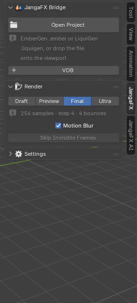
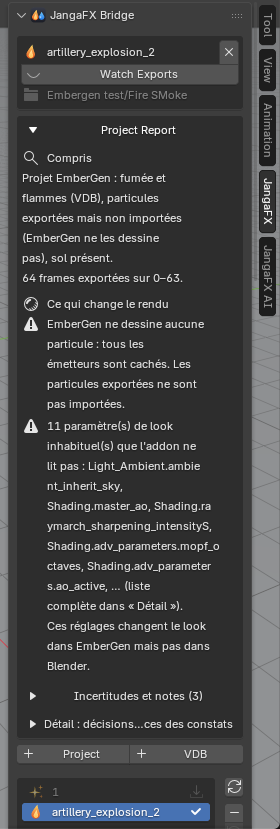

*[English version](en/premiers-pas.md)*

# Premiers pas avec LiquiGen

> Si l'add-on n'est pas encore installé, suivez d'abord la page [Installation](../installation.md).

## Avant de commencer

Dans LiquiGen :

1. exportez la simulation avec les nœuds d'export du projet (le liquide, et l'écume, les embruns ou les bulles si
   le projet les simule) ;
2. enregistrez le projet (`.liquigen`).

L'add-on retrouve les exports grâce aux nœuds d'export enregistrés dans le projet : un export fait avant le
dernier changement de chemin ne sera pas trouvé.

## Ouvrir le panneau JangaFX

Dans la vue 3D, appuyez sur **N** : le panneau latéral s'ouvre. Cliquez sur l'onglet **JangaFX** (sur le bord
droit du panneau). Tant qu'aucun projet n'est ouvert, il ne montre que le bouton **Open Project**, le bouton
**+ VDB**, la section **Render** et la section **Settings** (repliée).

## Ouvrir un projet LiquiGen

1. Cliquez sur **Open Project**.
2. Choisissez le fichier `.liquigen`.

Vous pouvez aussi **glisser le fichier du projet** depuis l'explorateur de fichiers directement dans la vue 3D.

L'add-on lit le projet, importe les exports et règle le reste automatiquement. Un projet lourd peut prendre
quelques secondes.

Si rien n'est trouvé, Blender affiche « No export of this project was found on disk (export it from EmberGen
first) » : faites d'abord l'export depuis LiquiGen (le message cite EmberGen, il vaut aussi pour LiquiGen).

Pour mettre **plusieurs effets** dans la même scène, cliquez **+ Project** sous la carte du projet (voir [Projet
et liste des exports](../panneau.md#projet-et-liste-des-exports)).

## Ce qui apparaît dans la scène

Après l'ouverture, la scène contient :

- une collection **JangaFX Bridge** avec le liquide (le maillage exporté, ou une surface reconstruite à partir des
  particules) et les particules blanches que le projet simule : écume, embruns, bulles ;
- la caméra du projet, le soleil et le ciel du projet, et le sol si le nœud Ground du projet est actif ;
- la plage d'images et la cadence de la scène calées sur celles de l'export.

Pour regarder le rendu dans la vue 3D, passez en mode d'affichage **Material Preview** ou **Rendered** (en haut à
droite de la vue 3D). Le rendu final se fait avec **Cycles**.

## Le dossier des exports

À l'ouverture, l'add-on prend comme **dossier des exports** le dossier où les nœuds d'export du projet écrivent
leurs fichiers ; il est affiché sous le nom du projet. Le bouton **Watching Exports** (œil) indique que ce dossier
est surveillé : quand vous réexportez depuis LiquiGen, la liste se met à jour et le liquide déjà importé est
rechargé (si **Auto Reload** est coché).

Pour surveiller un autre dossier, changez **Export Folder** dans la section **Settings** (voir
[Réglages](../panneau.md#réglages)).

## Le rapport du projet

Juste sous le nom du projet, le **Project Report** explique ce que l'add-on a compris du projet et ce qui peut
rendre le résultat différent de LiquiGen, le plus grave d'abord. Une copie texte est écrite à côté du projet
(`<projet>.jfxb_report.txt`).

Le détail de chaque partie du rapport est dans [Premiers pas](../premiers-pas.md#le-rapport-du-projet) de la
documentation complète.

## Et ensuite

- Réglez le liquide : [La section Liquid](liquide.md).
- Comparez à LiquiGen ou exportez : [Vérifier et exporter](verifier-et-exporter.md).
