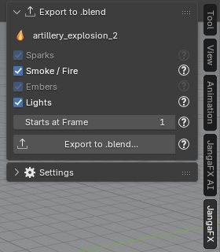

*[English version](en/verifier-et-exporter.md)*

# Vérifier et exporter

## Vérifier contre une capture LiquiGen

LiquiGen n'enregistre aucun rendu dans son projet : pour comparer, il faut une capture. Dans la section
**Liquid** :

1. faites une capture dans LiquiGen (un rendu, ou la vue 3D seule), **vue par la caméra du projet** ;
2. choisissez-la dans **LiquiGen Capture** ; **At Frame** prend l'image courante de la scène, corrigez-la si besoin
   pour qu'elle corresponde à l'image de la capture ;
3. cliquez sur **Check against LiquiGen**.

Le bouton reste grisé tant qu'il n'y a pas de capture ; la raison est écrite dessous. La comparaison porte sur la
forme, la luminosité, les couleurs et les reflets, et les différences s'ajoutent au rapport du projet.

> Les seuils de cette comparaison sont **provisoires** (pas encore mesurés sur des captures LiquiGen). Il n'y a pas
> d'Auto Match pour LiquiGen.

## Exporter le liquide en .blend

La section **Export to .blend** écrit le liquide dans un fichier `.blend` autonome que vous ajoutez ensuite à
n'importe quelle scène, **même sur un ordinateur sans l'add-on**.

1. Sélectionnez un objet du liquide (ou la ligne de l'export dans la liste) : la section affiche le nom du
   projet.
2. Cochez les parties à écrire :
   - **Liquid** : le liquide et ses particules blanches, avec leurs Geometry Nodes et leurs matériaux ;
   - **Volumes** : les volumes VDB du projet, s'il y en a ;
   - **Bubbles** : les bulles ajoutées par l'assistant IA (grisé s'il n'y en a pas) ;
   - **Lights** : le soleil du projet.
3. Réglez **Starts at Frame** : l'image du fichier qui reçoit le liquide où joue sa première image.
4. Cliquez sur **Export to .blend...** et choisissez où enregistrer le fichier.

Le fichier est écrit par un Blender d'arrière-plan ; votre fichier de travail n'est pas modifié. Le soleil
éclaire aussi toute la scène qui reçoit le liquide : décochez **Lights** pour garder seulement l'éclairage de
cette scène.

Les fichiers exportés par LiquiGen **ne sont pas copiés** : ils restent à leur chemin sur le disque. Ne déplacez
pas le dossier des exports tant que vous utilisez le liquide.

Pour ajouter le fichier à une autre scène (File > Append ou Asset Browser) et pour le détail de ce qui est figé,
voir [Exporter l'effet en .blend](../export.md).

## En cas de problème

La page [Dépannage](../depannage.md) liste les problèmes courants et leurs solutions.
