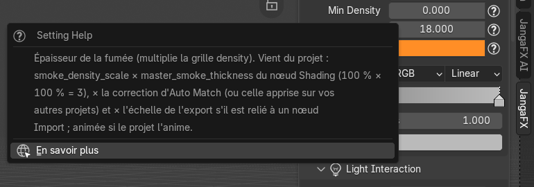
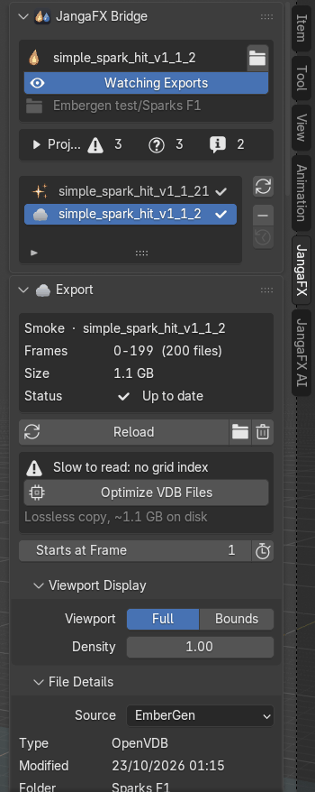
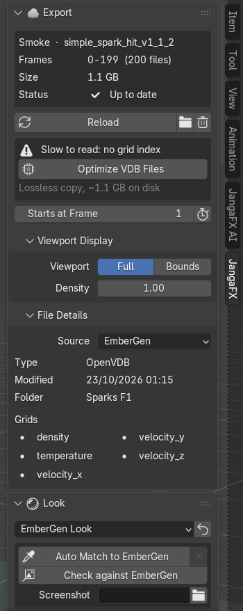
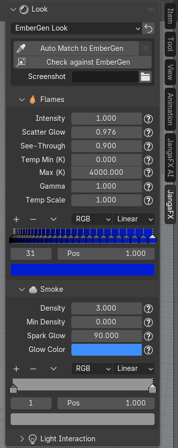
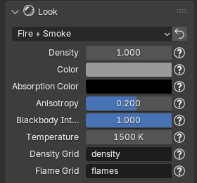
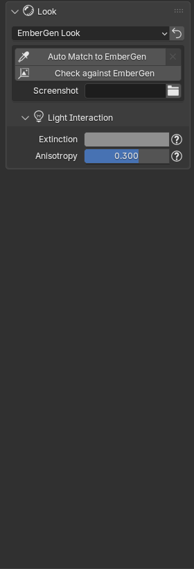
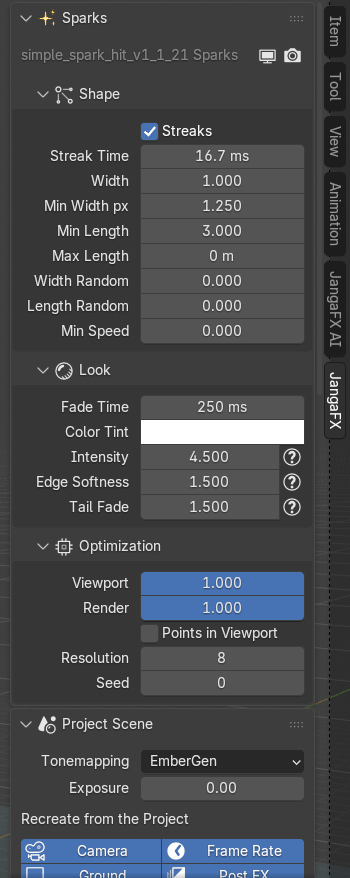
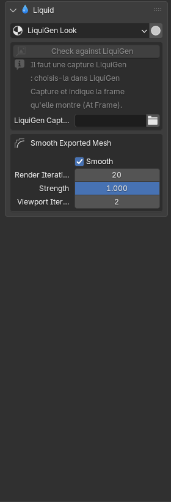
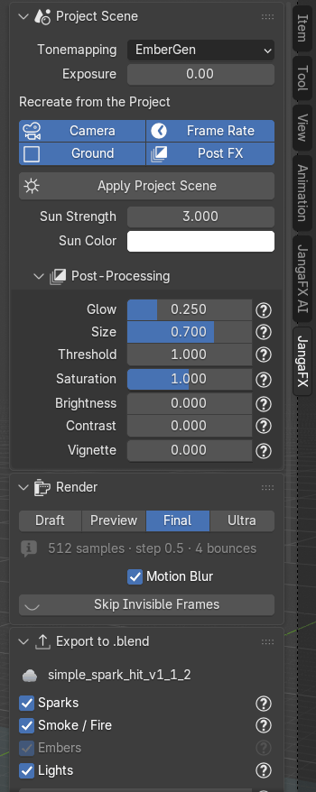
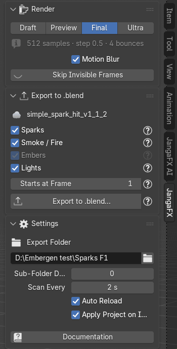

*[English version](en/panneau.md)*

# Le panneau JangaFX

Le panneau JangaFX (touche **N** dans la vue 3D, onglet **JangaFX**) est découpé en sections que vous pouvez
replier (clic sur le titre) ou réordonner (glisser la poignée `::::` à droite du titre). Une section n'apparaît que
si elle sert : par exemple **Sparks** seulement si le projet a des étincelles.

Partout, le bouton **?** à côté d'un réglage explique ce qu'il fait et d'où vient sa valeur (lue dans le projet,
mesurée, ou choisie par l'add-on). Survolez-le pour une bulle d'aide, cliquez dessus pour une fenêtre qui reste
ouverte, avec le lien **En savoir plus** vers cette documentation.

Les réglages des étincelles, du liquide et du rendu affichent aussi leur explication quand vous les survolez.

## Projet et liste des exports

La première section, **JangaFX Bridge**, montre le projet ouvert :

- le **nom du projet** et le bouton dossier (à droite) pour **ouvrir un autre projet** ;
- **Watching Exports / Watch Exports** : allume ou coupe la surveillance du dossier des exports ;
- le dossier surveillé (en gris) ;
- le [rapport du projet](premiers-pas.md#le-rapport-du-projet).

En dessous, la **liste des exports** trouvés : une ligne par export, avec une icône selon son rôle (fumée,
étincelles, liquide) et son état à droite :

- coche : importé et à jour ;
- flèches : le fichier a changé sur le disque, il faut le recharger ;
- triangle rouge : des fichiers manquent ;
- ligne grisée : pas encore importé.

Les boutons à droite de la liste :

- **Rescan** (flèches) : relit le dossier des exports tout de suite ;
- **Remove from Library** (−) : retire l'export sélectionné de la liste et son objet de la scène (les fichiers
  restent sur le disque) ;
- **Show Removed** : fait revenir les exports retirés.

## Export sélectionné

La section **Export** décrit la ligne choisie dans la liste : son rôle et son nom, les images (**Frames**), la
taille sur le disque (**Size**), l'état (**Status**) et les images manquantes s'il y en a.

- Export pas encore importé : **Import** l'ajoute à la scène, le bouton dossier ouvre son dossier.
- Export importé :
  - **Reload** : le recharge depuis le disque ;
  - bouton dossier : ouvre son dossier dans l'explorateur ;
  - corbeille (**Remove**) : supprime l'objet importé (les fichiers restent sur le disque).
- **Slow to read: no grid index** et **Optimize VDB Files** : les VDB d'EmberGen n'ont pas de table des grilles,
  Blender relit tout le fichier pour chaque grille à chaque image. **Optimize VDB Files** écrit une copie indexée
  (mêmes grilles, mêmes valeurs, sans perte) dans un sous-dossier `JangaFX Optimized` et l'utilise. La taille
  approximative de la copie est indiquée dessous. Une fois fait, la ligne devient **Optimized VDB copy in use**.
- **Starts at Frame** : image de la scène où joue la première image de l'export. Le bouton à droite (**Fit Scene
  Range**) cale la plage d'images de la scène sur celle de l'export.

Deux sous-sections repliées :

- **Viewport Display** (volumes) : **Full** affiche le volume, **Bounds** seulement sa boîte (le plus rapide) ;
  **Density** change la densité dans la vue 3D seulement (pas au rendu).
- **File Details** : source (EmberGen, LiquiGen), type de fichier, date de modification, dossier et liste des
  grilles du VDB.

## Look

La section **Look** règle l'apparence du volume (fumée et feu). Elle suit l'export sélectionné ; si une autre ligne
est choisie, elle montre le premier volume importé (son nom est rappelé en gris en haut).

Le menu en haut choisit le **préréglage** :

- **EmberGen Look** (par défaut) : reproduit le rendu du projet EmberGen (`.ember`) ; sans projet trouvé, ce sont
  les valeurs par défaut d'EmberGen ;
- **Fire + Smoke**, **Smoke**, **Fire** : des looks simples (voir plus bas).

Le bouton flèche à droite (**Apply Preset**) reconstruit le matériau avec le préréglage choisi ; avec EmberGen Look,
le projet est relu. Attention : vos retouches à la main sont remplacées.

Avec **EmberGen Look**, un encadré propose :

- **Auto Match to EmberGen** et la croix à droite (**Reset Auto Match**) ;
- **Check against EmberGen** ;
- **Screenshot** : une capture d'écran d'EmberGen à utiliser comme référence (facultatif), et **At Frame**,
  l'image qu'elle montre.

Ces outils sont expliqués dans [Vérifier et Auto Match](verifier-et-auto-match.md).

### Looks simples

Avec **Fire + Smoke**, **Smoke** ou **Fire**, le volume utilise un matériau simple de Blender (Principled Volume)
dont les réglages sont affichés directement : densité, couleur, couleur d'absorption, direction de la diffusion
(**Anisotropy**), force du feu (**Blackbody Intensity**), température, et les grilles du VDB utilisées pour la
fumée (**Density Grid**) et pour le feu (**Flame Grid**). Ces valeurs viennent du préréglage, pas du projet.

### Flammes

Sous-section **Flames** (seulement si le projet a des flammes) :

- **Intensity** : force de la lumière des flammes ;
- **Scatter Glow** : lueur des flammes diffusée dans la fumée autour (lueur orange des explosions) ;
- **See-Through** : amincit la fumée là où il y a des flammes pour qu'elle ne les cache pas ;
- **Temp Min (K)** et **Max (K)** : températures du début et de la fin du dégradé de couleur des flammes ;
- **Gamma** : courbe de ce dégradé (au-dessus de 1, les flammes restent plus longtemps dans le bas du dégradé) ;
- **Temp Scale** : diviseur de la grille de température du VDB, mesuré à l'import ;
- le **dégradé de couleur** des flammes, lu dans le projet.

### Fumée

Sous-section **Smoke** :

- **Density** : épaisseur de la fumée ;
- **Min Density** : en dessous de ce seuil, la fumée n'est pas dessinée ;
- **Tint Temp Min** et **Max (K)** : quand la fumée est teintée par la température, températures du début et de
  la fin de son dégradé ;
- **Spark Glow** et **Glow Color** : lumière des étincelles diffusée dans la fumée, et sa couleur ;
- le **dégradé de couleur** de la fumée.

### Interaction avec la lumière

Sous-section **Light Interaction** (repliée) :

- **Extinction** : teinte de la fumée vue par la caméra ;
- **Shadow Tint** : teinte des ombres dans la fumée (seulement si le projet la règle à part) ;
- **Anisotropy** : direction de la diffusion de la lumière (positive : la fumée s'éclaire à contre-jour).

### Masquage émissif

Sous-section **Emissive Masking** (repliée, absente quand les flammes sont en « corps noir », sur lesquelles elle
n'agit pas) : éteint les flammes là où la fumée a une certaine densité, comme EmberGen.

- **Density Ref** : densité autour de laquelle les flammes sont éteintes ;
- **Width** : largeur de la transition ;
- **Ramp** : courbe du masque ;
- **Intensity** : force du masque (à 1, les flammes sont complètement éteintes à la densité de référence).

Ces réglages peuvent être animés si le projet les anime (losange de clé à droite).

## Étincelles

La section **Sparks** apparaît quand le projet a des particules (export Alembic). Elle reste visible quelle que soit
la ligne choisie dans la liste. En haut, l'objet des étincelles avec deux boutons : visible dans la vue 3D (écran)
et au rendu (appareil photo).

- **Shape** : forme des traînées. **Streaks** (traînées alignées sur la vitesse ; décoché : des points ronds),
  **Streak Time**, **Width**, **Min Width px** (largeur minimale à l'écran, en pixels), **Min Length**, **Max
  Length**, **Width Random**, **Length Random**, **Min Speed** (cache les particules plus lentes, par exemple
  posées au sol).
- **Look** : **Fade Time**, **Color Tint** (multiplie la couleur), puis **Intensity** (luminosité), **Edge
  Softness** (douceur des bords) et **Tail Fade** (extinction de la queue des traînées).
- **Optimization** (repliée) : affichage dans la vue 3D et au rendu, **Points in Viewport** (des points au lieu des
  traînées dans la vue, le rendu garde les traînées), **Resolution** (segments des traînées) et **Seed**.

Survolez un réglage pour lire d'où vient sa valeur.

Si la section affiche « Older spark setup: reload the export to get every setting », rechargez l'export
(**Reload**) pour avoir tous les réglages.

## Liquide

La section **Liquid** apparaît avec un projet LiquiGen.

- Le menu **LiquiGen Look** choisit le matériau du liquide : l'apparence du projet LiquiGen, ou l'un de vos
  matériaux d'eau trouvés dans vos bibliothèques d'assets (ajouté une fois, textures reliées).
- Le bouton à droite (**Detail Preview**) règle la vue 3D pour bien lire les détails du liquide (mode Solid,
  matcap brillant, écume en blanc, plus de lissage).
- Un encadré **Check against LiquiGen** avec **LiquiGen Capture** et **At Frame** (voir
  [Vérifier un projet LiquiGen](verifier-et-auto-match.md#vérifier-un-projet-liquigen)).
- **Surface Foam** : écume peinte sur la surface (on/off dans la vue et au rendu), son **Shader** (vide : écume
  blanche intégrée), sa quantité et sa forme : **Coverage**, **Threshold**, **Softness**, **Lace Scale**, **Lace
  Width**, **Lace Amount**, **Distortion**, **Foam Height**, et pour la mousse **Bubble Size**, **Bubble
  Variation**, **Bubble Relief**, **Translucency**, **Color**. Ces valeurs sont des choix de l'add-on, pas lus dans
  le projet.
- **Smooth Exported Mesh** : lissage du maillage exporté par LiquiGen.
- **Surface from Particles** : surface reconstruite à partir des particules (cachée quand le maillage exporté est
  utilisé).
- Une boîte par type de particules blanches (écume, embruns, bulles), avec son bouton de rendu.

## Scène du projet

La section **Project Scene** recrée l'ambiance du projet :

- **Tonemapping** : **EmberGen** (la courbe du projet, comme EmberGen), **Filmic** (hautes lumières douces, les
  flammes deviennent jaune pâle), **AgX** (celui de Blender) ou **Realistic** (comme une photo d'explosion : corps
  orange, cœur jaune-blanc) ;
- **Exposure** : exposition en plus de ce réglage, en stops ;
- **Recreate from the Project** : ce que **Apply Project Scene** doit recréer :
  - **Camera** : la caméra d'EmberGen (champ de vision, orbite, distance) ;
  - **Ground** : le sol du projet, pour que l'effet l'éclaire et s'y reflète ;
  - **Frame Rate** : la cadence du projet ;
  - **Post FX** : le post-traitement du projet ;
- **Apply Project Scene** : recrée les lumières, le tonemapping, le post-traitement, la qualité de rendu et,
  si coché, la caméra ;
- **Sun Strength** et **Sun Color** : force et couleur du soleil du projet.

### Post-traitement

Sous-section **Post-Processing** (repliée), quand le projet a un post-traitement. Il est refait dans le
compositing de Blender :

- **Glow**, **Size**, **Threshold** : force et taille du halo autour des zones lumineuses, et luminosité à partir
  de laquelle il apparaît ;
- **Saturation**, **Brightness**, **Contrast** : couleurs de l'image finale ;
- **Vignette** : assombrissement des bords ;
- une ligne « Channel swap … (from the project) » si le projet échange les canaux de couleur.

## Rendu

La section **Render** :

- **Draft / Preview / Final / Ultra** : qualité du rendu Cycles. Draft est le plus rapide (pour le timing et le
  cadrage), Preview pour juger le look, Final pour la production, Ultra sans limite de temps. La ligne grise dessous
  résume les échantillons, le pas du volume et les rebonds de lumière.
- **Motion Blur** : flou de mouvement calculé avec la vitesse exportée (Cycles).
- **Skip Invisible Frames** : ne rend pas l'effet aux images où la caméra active ne le voit pas (pas encore
  simulé, hors champ ou réduit à quelques pixels) ; relancez-le après avoir changé la caméra ou la plage d'images.
  Le bouton œil à côté (**Render All Frames**) annule cela.

## Export en .blend

La section **Export to .blend** écrit l'effet dans un fichier `.blend` à ajouter dans une autre scène. Tout est
expliqué dans [Exporter l'effet en .blend](export.md).

## Réglages

La section **Settings** (repliée) :

- **Export Folder** : le dossier où EmberGen et LiquiGen écrivent leurs exports (rempli par Open Project) ;
- **Sub-Folder Depth** : nombre de niveaux de sous-dossiers parcourus ;
- **Scan Every** : temps entre deux lectures du dossier (quand la surveillance est allumée) ;
- **Auto Reload** : recharge tout seul un export importé quand ses fichiers changent ;
- **Apply Project on Import** : à l'import d'un export qui a son projet à côté, applique tout seul ses lumières,
  son tonemapping, son post-traitement et sa qualité de rendu ;
- **Documentation** : ouvre cette documentation dans votre navigateur.

