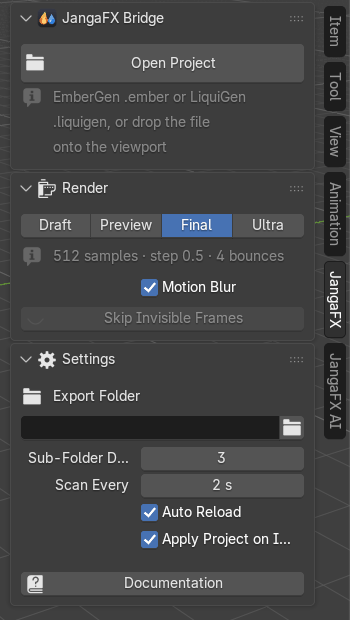
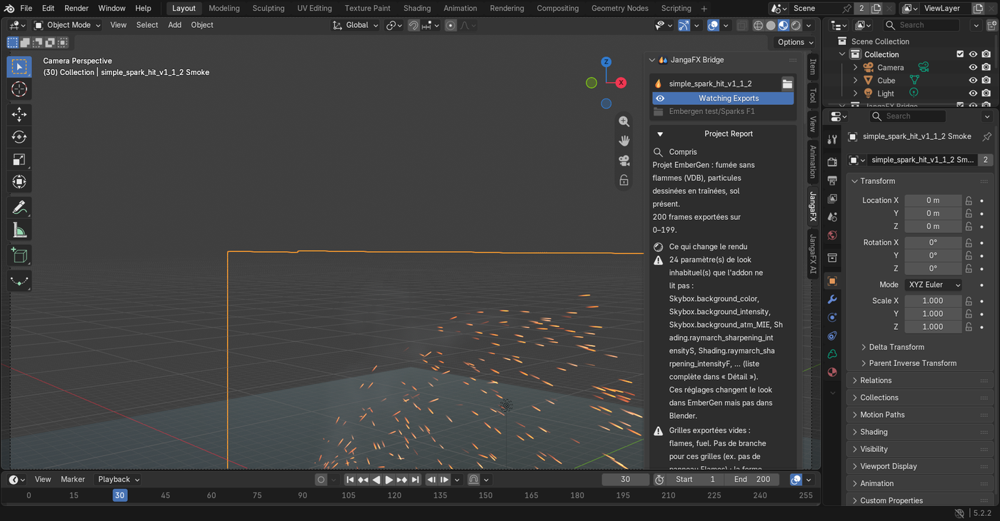
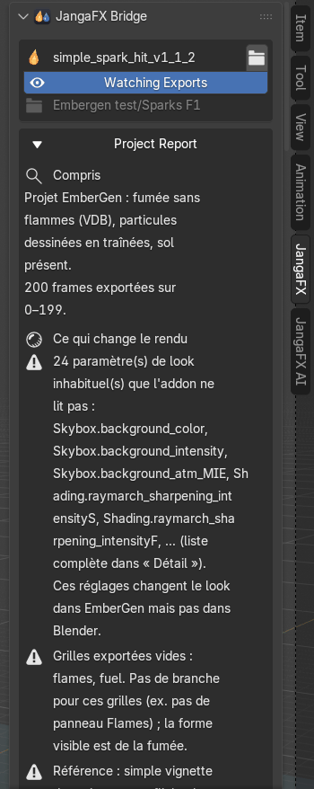
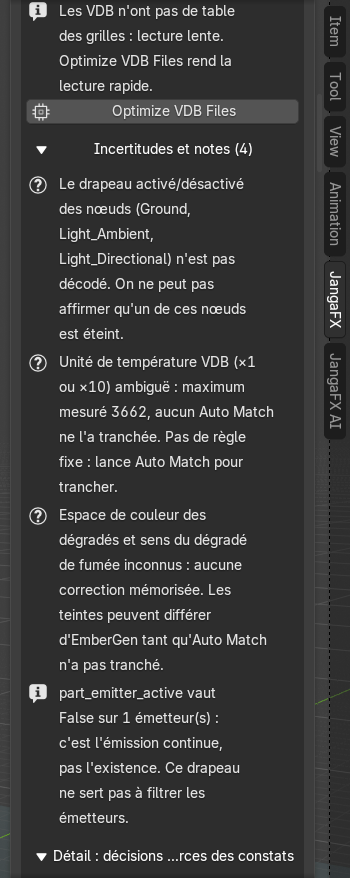

# Premiers pas

Avant de commencer : exportez votre effet depuis EmberGen (VDB pour la fumée et le feu, Alembic pour les
particules) ou depuis LiquiGen, et enregistrez le projet (`.ember` ou `.liquigen`).

## Ouvrir le panneau JangaFX

Dans la vue 3D, appuyez sur **N** : le panneau latéral s'ouvre. Cliquez sur l'onglet **JangaFX** (sur le bord
droit du panneau). Tant qu'aucun projet n'est ouvert, il ne montre que le bouton **Open Project**, la section
**Render** et la section **Settings** (repliée).

## Ouvrir un projet EmberGen ou LiquiGen

1. Cliquez sur **Open Project**.
2. Choisissez le fichier `.ember` (EmberGen) ou `.liquigen` (LiquiGen).

Vous pouvez aussi **glisser le fichier du projet** depuis l'explorateur de fichiers directement dans la vue 3D.

L'add-on lit le projet, retrouve les exports grâce aux nœuds d'export du projet, les importe et règle tout le
reste automatiquement : matériaux, lumières, caméra, post-traitement, cadence (images par seconde) et plage
d'images de la scène. Un projet lourd peut prendre quelques secondes.

Si rien n'est trouvé, Blender affiche « No export of this project was found on disk (export it from EmberGen
first) » : faites d'abord l'export depuis EmberGen ou LiquiGen.

## Ce qui apparaît dans la scène

Après l'ouverture, la scène contient :

- une collection **JangaFX Bridge** avec l'effet : le volume (fumée, feu) et, s'il y en a, les étincelles ou le
  liquide ;
- la caméra du projet (si **Camera** est activé dans [Scène du projet](panneau.md#scène-du-projet)), le sol du
  projet et ses lumières (le soleil d'EmberGen, par exemple) ;
- la plage d'images de la scène calée sur celle de l'export.

Pour regarder le rendu dans la vue 3D, passez en mode d'affichage **Material Preview** ou **Rendered** (en haut à
droite de la vue 3D). Le rendu final se fait avec **Cycles**.

## Le dossier des exports

À l'ouverture, l'add-on prend comme **dossier des exports** le dossier où les nœuds d'export du projet écrivent
leurs fichiers (le dossier du projet s'il n'en trouve pas) ; il est affiché sous le nom du projet. Le bouton **Watching Exports** (œil) indique que ce dossier est surveillé : quand vous réexportez depuis
EmberGen, la liste se met à jour et les effets déjà importés sont rechargés (si **Auto Reload** est coché).

Pour surveiller un autre dossier, ouvrez la section **Settings** et changez **Export Folder** (voir
[Réglages](panneau.md#réglages)).

## Le rapport du projet

Juste sous le nom du projet, le **Project Report** explique ce que l'add-on a compris et ce qui peut rendre le
résultat différent d'EmberGen. Il est écrit dans la langue choisie dans les préférences de l'add-on (français par
défaut). Une copie texte est aussi écrite à côté du projet (`<projet>.jfxb_report.txt`).

Il est découpé en parties :

- **Compris** : ce que contient le projet (fumée, flammes, particules, sol, nombre d'images exportées).
- **Ce qui change le rendu** : les points qui rendent le rendu de Blender différent de celui d'EmberGen, le plus
  grave d'abord. L'icône dit la gravité (croix rouge : problème ; triangle : attention). Quand une solution existe,
  un bouton apparaît juste en dessous (par exemple **Optimize VDB Files** ou **Auto Match to EmberGen**). Si tout
  va bien, la ligne dit « Rien trouvé ».
- **Incertitudes et notes** (repliée) : ce que l'add-on n'a pas pu trancher et les simples informations.
- **Détail : décisions du plan et sources des constats** (repliée) : chaque décision prise à l'ouverture, avec
  d'où vient la valeur. Utile pour comprendre, pas nécessaire au quotidien.

Cliquez sur le titre **Project Report** pour replier le rapport : une seule ligne reste, avec le nombre de
constats par gravité.

## Et ensuite

- Découvrez chaque section du panneau : [Le panneau JangaFX](panneau.md).
- Comparez votre rendu à celui d'EmberGen : [Vérifier et Auto Match](verifier-et-auto-match.md).
- Mettez l'effet dans une autre scène : [Exporter l'effet en .blend](export.md).
